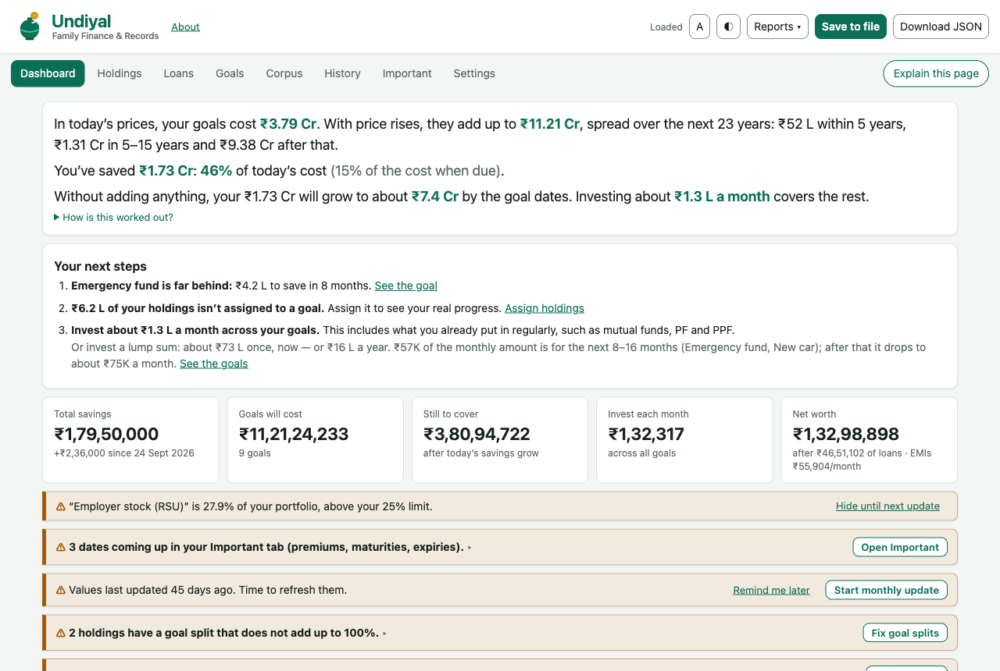
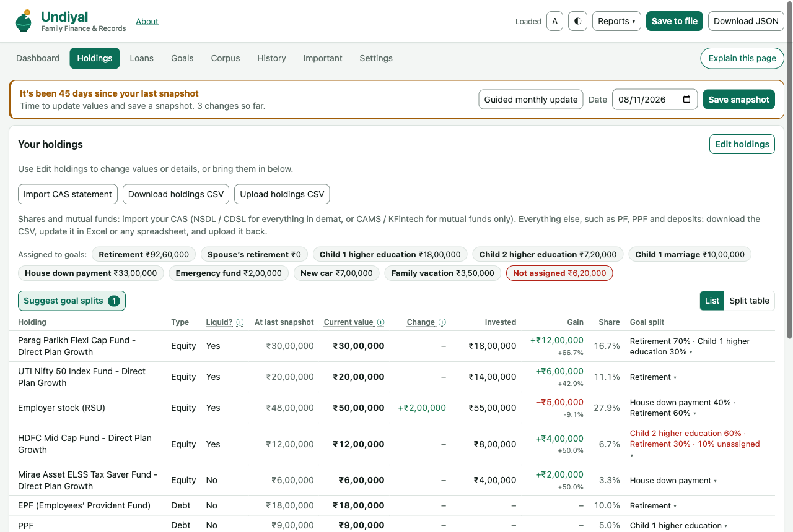
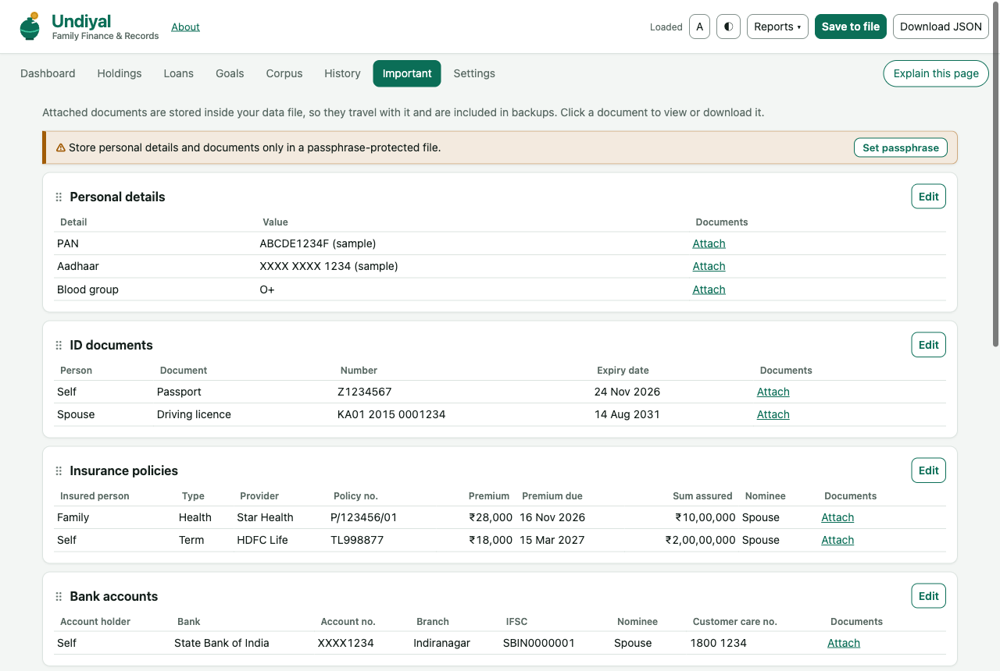
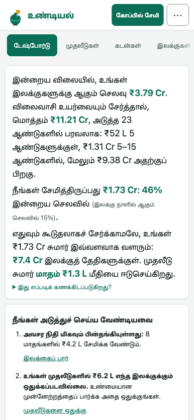

  <picture>
    <source media="(prefers-color-scheme: dark)" srcset="logo/undiyal-logo-dark.svg">
    
  </picture>

  <b>A private, offline family finance and records tracker for Indian households.</b> 
  One HTML file. No account, no server, no tracking. Your data stays on your device.

  <a href="#get-started">Get started</a> ·
  <a href="docs/USER-GUIDE.md">User guide</a> ·
  <a href="#privacy">Privacy</a> ·
  <a href="#disclaimer">Disclaimer</a>

---

An *undiyal* (உண்டியல்) is the little savings box many of us had as children: you drop in a coin whenever you can, and one day there is enough for something that matters. Undiyal brings that habit to your family's whole financial life: what you are saving for, what you already own, and the important papers your family may one day need.

## What it does

- **Goals:** retirement, children's education and marriage, a house, an emergency fund. See what each goal costs today and when it falls due, how far along you are, and how much to invest each month (or as a lump sum).
- **Holdings:** mutual funds, shares, ETFs, PF, PPF, NPS, deposits and savings in one list, with what you invested and what it is worth now. Split any holding across goals.
- **Statement import:** reads NSDL, CDSL (including the bilingual layout) and CAMS / KFintech / MF Central CAS PDFs in your browser, including password-protected and AES-256 encrypted files. Folio numbers go to your records automatically.
- **Plain-language dashboard:** next steps, on-track status for each goal, rebalancing by goal, alerts for premiums, maturities and expiries, and six charts you can reorder or hide.
- **Loans and net worth:** EMI, outstanding principal and interest still to pay, worked out for you.
- **Important records:** insurance, bank accounts, IDs, deposits, demat accounts, folios, property and locker details, with scanned documents attached.
- **Sharing:** a simple family summary, or a detailed report for an adviser with the sections you choose, as HTML or PDF.
- **Five languages:** English, Hindi, Tamil, Telugu and Kannada.
- **Works on a phone:** Android Chrome is fully supported, with layouts designed for small screens.

| Holdings | Important records | Tamil, on a phone |
|---|---|---|
|  |  |  |

## Get started

1. Download [`Undiyal.html`](Undiyal.html), or the latest release zip.
2. Open it in **Chrome or Edge** on a computer, or **Chrome on Android**.
3. Choose **Start the setup wizard**, or **Try it with sample data** to look around first.

There is nothing to install and no sign-up. To try a full example, open [`undiyal-sample-all-cases.json`](undiyal-sample-all-cases.json) from the start screen. It is made-up data that shows every status, alert and chart.

**Browser support**

| Browser | Status |
|---|---|
| Chrome / Edge (Windows, Mac, Linux) | Full: saves straight to your file |
| Chrome (Android) | Full: saves straight to your file |
| Firefox / Safari | Works; use **Download JSON** to save changes |
| iPhone / iPad | Not supported (iOS cannot run a local HTML file) |

## Privacy

- **Everything stays on your device.** Undiyal makes no network requests. Your data lives in one JSON file that you choose and keep.
- **Optional encryption.** Set a passphrase and the whole file is encrypted with AES-256-GCM. Without the passphrase it cannot be opened, so keep the passphrase safe.
- **Statements are read locally.** CAS PDFs are decrypted and read in your browser. Nothing is uploaded.
- **Browser storage:** Chrome and Edge remember only which file you used. In Firefox and Safari, unsaved changes are kept in the browser (encrypted if you set a passphrase) until you download them.

## How it works

- A single self-contained file (`Undiyal.html`) with HTML, CSS and plain JavaScript. There are no dependencies, frameworks or build step.
- It saves with the File System Access API where available and falls back to downloads elsewhere.
- The PDF reader (RC4, AES-128 and AES-256 decryption, object streams, font maps) and the statement parsers are written from scratch and run in the browser.
- Goal maths uses your own expected returns and inflation. Rebalancing follows a simple glide path, with more equity for long-term goals and moving towards debt as a goal nears. It respects money that is locked in (PF, PPF, ELSS).

## Contributing

Feedback and fixes are welcome. Areas where help is especially useful:

- **Translations:** the Hindi, Tamil, Telugu and Kannada text is machine-assisted and needs review by native speakers.
- **Statement formats:** if a CAS does not import correctly, please open an issue that describes the layout. **Never attach a real statement or personal data.**
- **Testing** on more devices and browsers.

## Disclaimer

Undiyal is a personal tracking tool, **not financial advice**. Its creator is not a SEBI-registered investment adviser. Targets, monthly amounts, rebalancing suggestions and loan figures are estimates based on your own assumptions. Actual results will differ, and figures are before tax and charges. Always check imported values against your official statements. CAMS, KFintech, MF Central, NSDL, CDSL and other names belong to their owners, and Undiyal is not affiliated with them. See the [full disclaimer](docs/USER-GUIDE.md#disclaimer).

## Licence

[MIT](LICENSE) © 2026 The Undiyal authors. Free to use, share and modify; provided as is, without warranty.
